# Кабинет допуска подрядчика

Прототип сервиса для подрядных организаций Павлодара и Экибастуза (ремонт, электромонтаж, металлоконструкции), которые выходят на объекты ПНХЗ, экибастузских ГРЭС-1 и ГРЭС-2, предприятий ERG (алюминиевый, электролизный, ферросплавный заводы) и других заказчиков.

**Боль.** Перед выходом на объект на каждого работника нужно собрать пакет допуска: удостоверения по охране труда, промбезопасности, электробезопасности с группой, работам на высоте, медосмотр, психосвидетельствование, инструктажи, СИЗ. Сроки истекают в разное время, список ведётся в Excel, заказчик возвращает пакеты из-за одного просроченного удостоверения.

**Что делает кабинет.**

- Реестр работников (ФИО, ИИН с проверкой контрольной суммы, должность, разряд, участок, фото) и их документов со сканами.
- Светофор готовности: готов / истекает через 30-14-7 дней / не готов, с объяснением, чего не хватает.
- Сводка «кто может выйти завтра» по базовым документам или по любому профилю требований заказчика.
- Профили требований: какой набор документов нужен для вида работ у заказчика («ПНХЗ: огневые работы», «ГРЭС: работы в электроустановках», «ERG: работы на высоте» и др.).
- Заявки на допуск: объект, вид работ, даты, список работников, проверка каждого по профилю на даты работ.
- Выгрузки: пакет допуска ZIP (сводный PDF-список + сканы по папкам работников + xlsx на пропуск + подпись), список на пропуск xlsx, реестр сроков xlsx.
- Подпись списка ЭЦП через NCALayer (ключ не покидает компьютер), режим эмуляции для прототипа.
- Ежедневные уведомления о сроках в Telegram и на почту, журнал уведомлений.
- Импорт работников и документов из Excel.
- Кабинет заказчика: представитель заказчика видит поданные ему заявки, документы и сканы, ставит «допущены» или «замечания» с комментарием.

**Кому продаём.** Сначала самим подрядчикам по подписке (МСБ, без тендера), затем подключаем заказчика, к которому уже ходят подрядчики из базы.

> **Профили требований примерные.** Наборы документов для ПНХЗ, ГРЭС и ERG в начальных данных составлены как пример. У каждого заказчика свой стандарт работы с подрядными организациями, он меняется. Профили и сроки действия документов настраиваются в кабинете под требования конкретного заказчика (раздел «Объекты и профили», «Справочник документов»).

## Схема

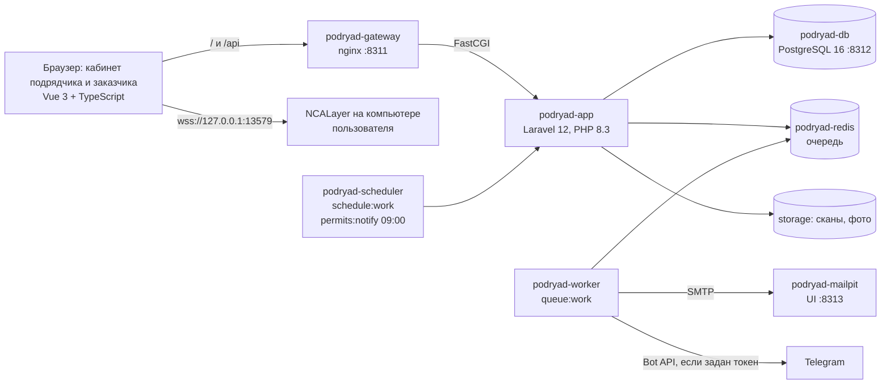

Расчёт готовности (`backend/app/Services/Readiness.php`): для каждого требования профиля берётся лучший документ этого типа (самый поздний срок, бессрочный лучше всех, группа ЭБ не ниже нужной). Нет документа, просрочен или мала группа: «не готов». Остаток не больше 30/14/7 дней (пороги настраиваются) или окончание до конца работ по заявке: «истекает». Иначе «готов».

## Запуск

Нужен только Docker (Compose v2). Всё собирается в контейнерах, на машину ничего не ставится.

```sh
make up        # создаёт .env со случайными паролями, собирает образы, поднимает стек
make test      # PHPUnit (отдельная БД podryad_test) + vue-tsc
make verify    # сквозная проверка на живом стеке (Playwright), см. tools/e2e.py
make layout    # проверка вёрстки 1440/1024/768/390
make notify    # проверить сроки и отправить уведомления сейчас
make seed      # пересоздать начальные данные
make down      # остановить (тома остаются)
```

| Адрес | Что |
|---|---|
| http://127.0.0.1:8311 | кабинет |
| http://127.0.0.1:8311/api | API |
| http://127.0.0.1:8311/docs/api/ | OpenAPI (Swagger UI) |
| http://127.0.0.1:8313 | Mailpit, письма с уведомлениями |
| 127.0.0.1:8312 | PostgreSQL |

Все порты слушают только 127.0.0.1. Первый `make up` на чистой машине ставит зависимости composer в контейнере, это несколько минут.

Настройки в `.env` (шаблон `.env.example`):

- `SIGN_MODE=emulate` или `ncalayer`;
- `TELEGRAM_BOT_TOKEN`, `TELEGRAM_CHAT_ID` (чат можно указать и в настройках организации). Без токена сообщения пишутся в журнал уведомлений и лог;
- `NOTIFY_TIME=09:00`, время ежедневной проверки по Алматы.

## Входы

Пароль у всех: `portal2026`.

| Логин | Роль |
|---|---|
| head@ertis.test | руководитель подрядчика: всё, включая настройки и пользователей |
| ot@ertis.test | специалист по ОТ: работники, документы, подпись и подача заявок |
| master@ertis.test | мастер: просмотр, черновики заявок |
| ot.pnhz@zakazchik.test | представитель заказчика ПНХЗ |
| ot.gres1@zakazchik.test | представитель заказчика ГРЭС-1 |
| ot.kez@zakazchik.test | представитель заказчика КЭЗ (ERG) |

Начальные данные выдуманные: ТОО «Ертіс Монтаж Сервис» (БИН 150340012340), 28 работников с казахскими и русскими ФИО и ИИН с верной контрольной суммой, документы со сроками, отсчитанными от дня заполнения базы (часть истекает, часть просрочена), сканы-заглушки с надписью «образец удостоверения», 3 объекта, 5 профилей требований, 3 заявки: допущена (ГРЭС-1), подана (ПНХЗ), черновик с неготовыми работниками (КЭЗ).

## Подпись ЭЦП

`frontend/src/services/signer.ts`: подключение к NCALayer по `wss://127.0.0.1:13579`, модуль `kz.gov.pki.knca.basics` (метод `sign`, формат `cms`, данные вложены), при его отсутствии запасной `kz.gov.pki.knca.commonUtils.createCAdESFromBase64`. Подписываются канонические данные списка (JSON: заявка, подрядчик, заказчик, объект, период, работники с документами и сроками), сервер хранит CMS и SHA-256 данных. Любое изменение состава или документов делает подпись недействительной, подать заявку можно только с действительной подписью.

В режиме `SIGN_MODE=emulate` подпись делает сервер (заглушка с HMAC на ключе приложения) и проверяет, что подписаны именно текущие данные. В интерфейсе висит метка «Подпись: эмуляция».

## Структура

```
backend/     Laravel 12: API, расчёт готовности, выгрузки, импорт, уведомления, тесты
frontend/    Vue 3 + TypeScript (Vite): кабинет подрядчика и заказчика
docker/      Dockerfile PHP (gd, DejaVu), nginx-шлюз, init тестовой БД
docs/        openapi.yaml, screenshots/
tools/       make-env.sh, e2e.py (сквозная проверка), screenshots.py (скриншоты и вёрстка)
```

## Скриншоты

| | |
|---|---|
| 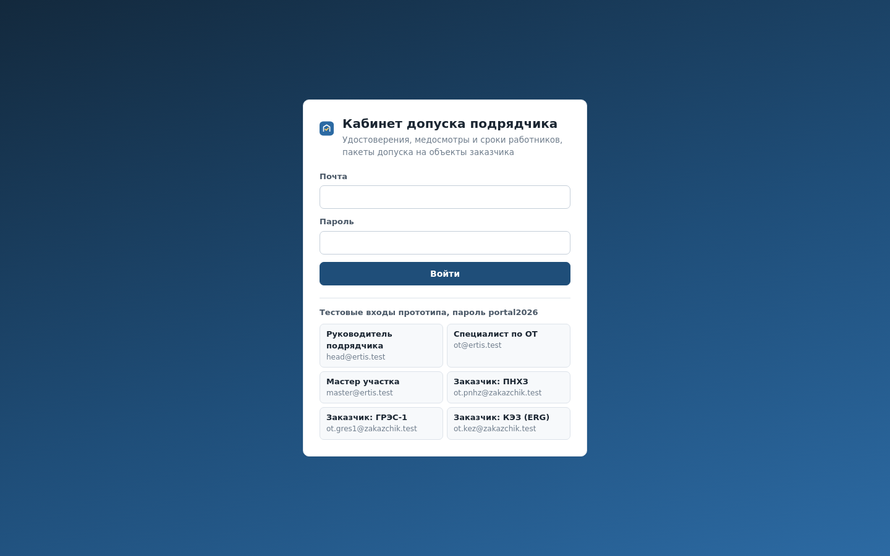 | 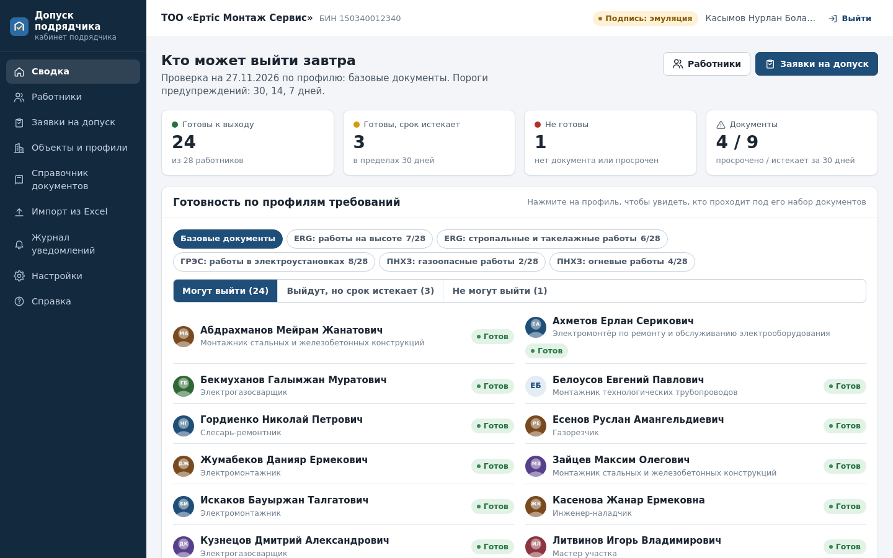 |
| 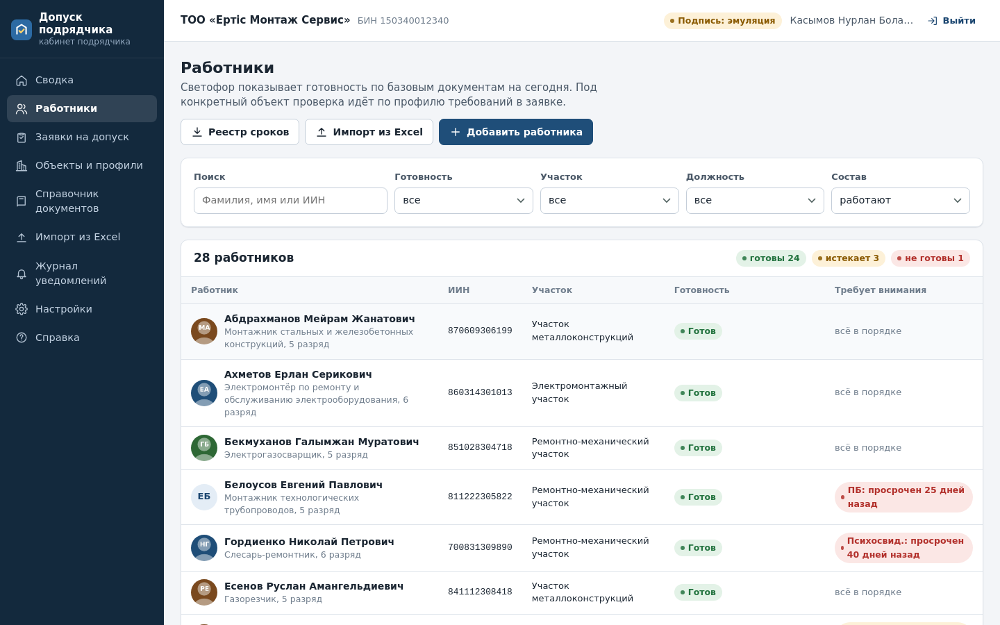 | 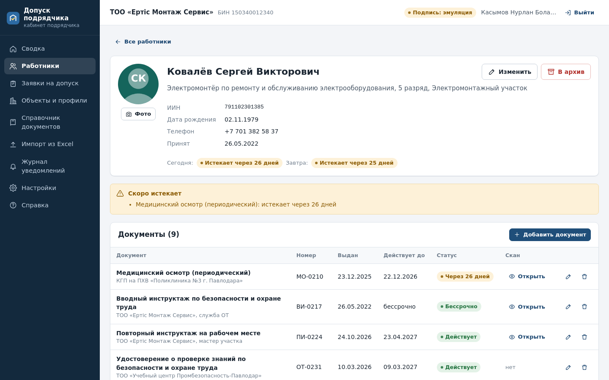 |
| 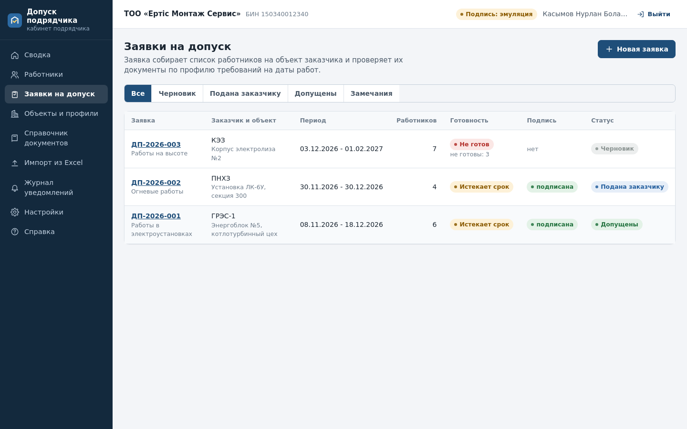 | 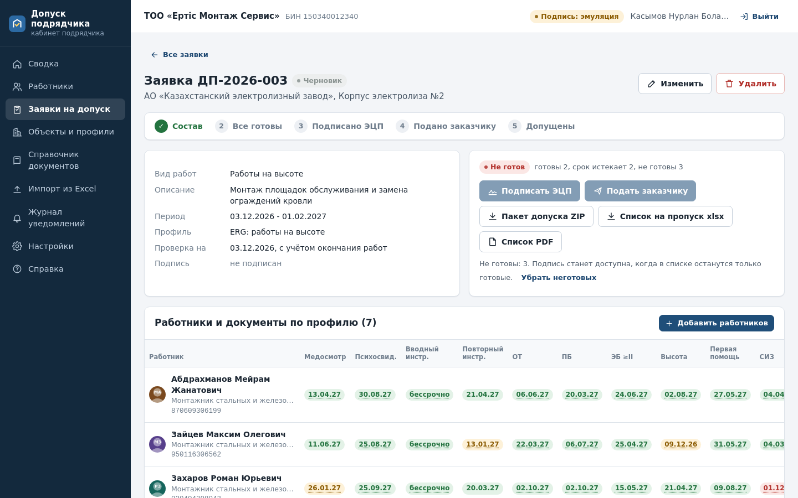 |
| 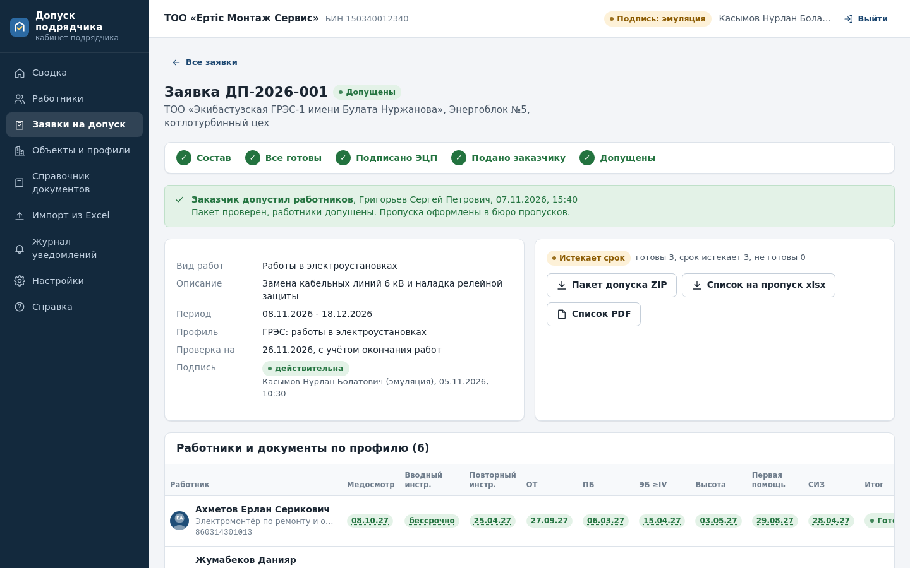 | 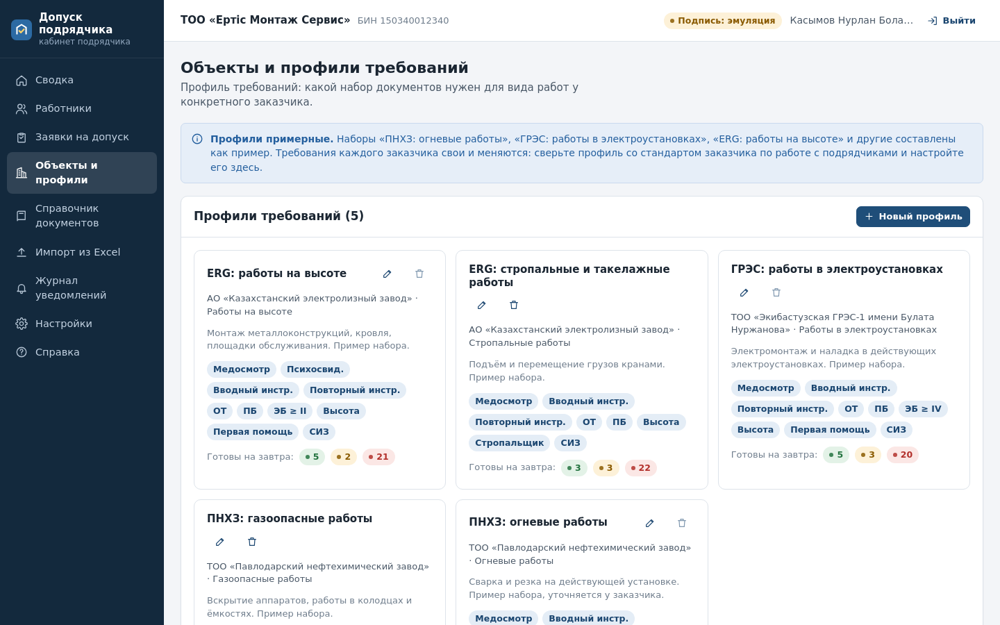 |
| 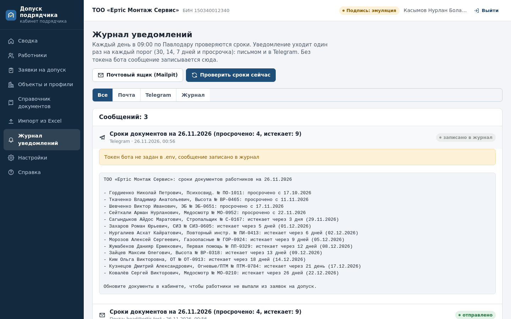 | 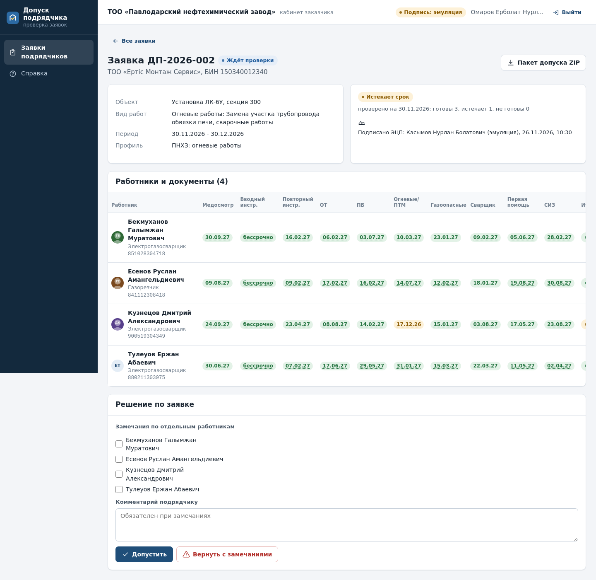 |
| 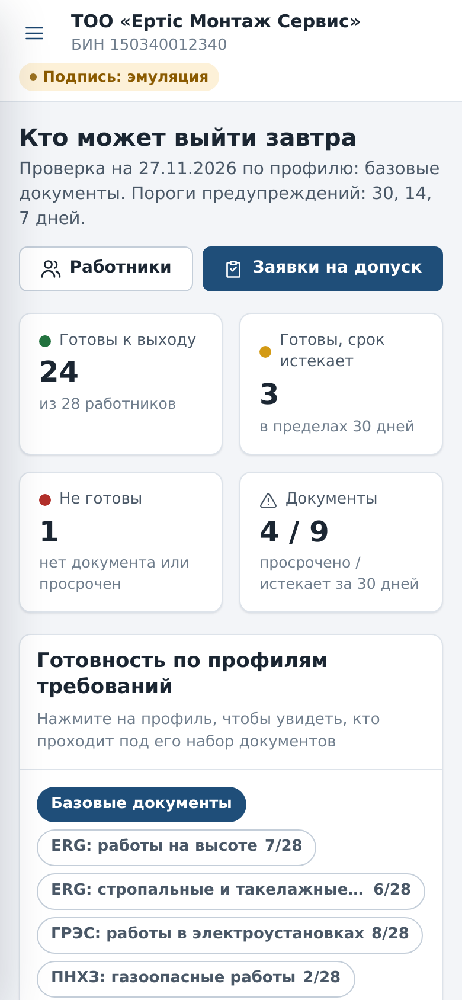 | 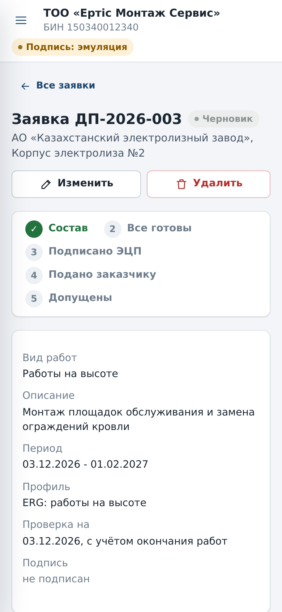 |

## Ограничения прототипа

- Настоящая ЭЦП не проверялась: ключа нет, гонялся режим эмуляции. В режиме NCALayer сервер принимает CMS без криптографической проверки ГОСТ (подписант извлекается через OpenSSL, если получится). Проверка через NCANode или сервис НУЦ РК: отдельная задача.
- Профили требований и сроки документов примерные, их надо сверять со стандартами заказчиков.
- Telegram без токена бота не проверен вживую, отправка проверена тестом с подменой HTTP.
- Заказчики и объекты общие для всех подрядчиков; нет мультиарендности с отдельными доменами, нет восстановления пароля, нет TLS на шлюзе.
- Токен для картинок и сканов передаётся параметром `?token=` в ссылке (удобно для ``, для боевой версии лучше короткоживущие подписанные ссылки).
- Нет интеграций со СКУД, бюро пропусков, 1С:ЗУП (оттуда удобно забирать работников).

## Следующий шаг

Модуль наряда-допуска поверх тех же данных: наряд на огневые, газоопасные, высотные работы и работы в электроустановках формируется из заявки, бригада подбирается только из «готовых» по профилю, проверяются группы ЭБ у производителя работ и допускающего, фиксируются целевые инструктажи и подписи ЭЦП ответственных лиц, заказчик видит открытые наряды на своих объектах. Затем интеграция с 1С:ЗУП подрядчика и учёт обучения (заявки в учебный центр по истекающим удостоверениям).
